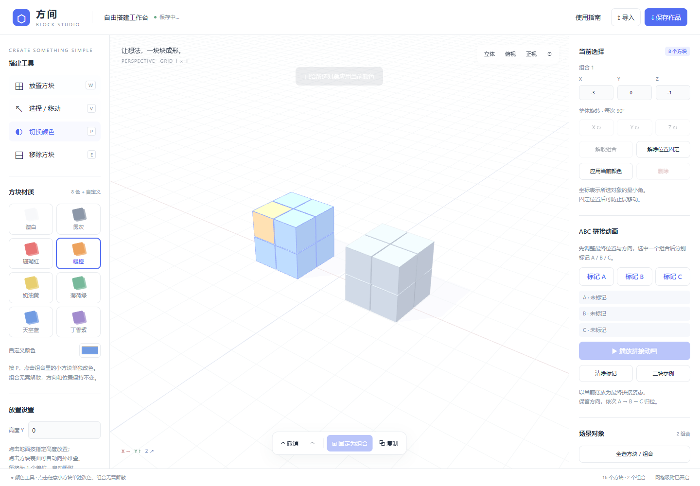

# 方间 · Fangjian Block Studio

一个可离线使用的三维积木网页：自由搭建小正方体，固定为整体，移动旋转拼接，并播放 ABC 装配动画。

## 使用

下载仓库 ZIP 并解压，用最新版 Chrome 或 Edge 打开 index.html 即可。无需安装依赖、服务器或联网。

也可以直接打开仓库中的 方间-积木工作台.html，它是包含所有依赖的单文件版本，方便分享。

## 功能

- 八种预设颜色与自定义颜色；组合内的小方块可单独改色。
- 点击地面或方块表面放置，支持指定高度和悬空搭建。
- 多选组合、解散、复制，以及按面邻接的一键自动组合。
- 三轴移动箭头、Alt 拖动升降、旋转圆环和正反向 90° 按钮。
- 整数网格吸附、重叠检测、位置锁定、撤销与重做。
- ABC 标记与顺序拼接动画，支持暂停、重播和进度拖动。
- 浏览器本地自动保存，JSON 作品导出与导入。

## 快捷键

| 按键 | 操作 |
| --- | --- |
| W / V / P / E | 放置 / 选择 / 改色 / 删除 |
| T / R | 移动箭头 / 旋转圆环 |
| G / Shift+G | 组合 / 解散 |
| Shift+点击 | 多选 |
| Alt+拖动 | 上下移动 |
| Ctrl+A / Ctrl+D | 全选 / 复制 |
| Ctrl+Z / Ctrl+Shift+Z | 撤销 / 重做 |
| F | 聚焦场景 |
| Esc | 取消选择 / 退出拼接动画 |

右键拖动旋转视角，滚轮缩放，中键平移。完整说明见 [使用说明](使用说明.md)。

## 开发与发布

主要界面和搭建逻辑位于 index.html；三维库位于 vendor/，不依赖在线 CDN。

运行 node build.mjs 可从 index.html 和本地依赖生成单文件网页。无需 npm install。

开启 GitHub Pages 时，选择从 main 分支的根目录发布即可。

## 范围

支持最多 3000 个方块，X/Z 坐标为 -50 至 50，Y 为 0 至 50。物体自身按 90° 旋转以保持拼接网格；观察视角自由旋转。不模拟重力。拼接动画展示预设直线归位，不进行装配路径碰撞规划。主要面向桌面鼠标与键盘。

## 开源与许可

原创界面及搭建逻辑以 [MIT License](LICENSE) 发布。

使用 [Three.js r128](https://github.com/mrdoob/three.js) 及同版本 OrbitControls、TransformControls（MIT），许可保存在 [vendor/THREE-LICENSE.txt](vendor/THREE-LICENSE.txt)。

交互参考：[Three.js Voxel Painter](https://threejs.org/examples/#webgl_interactive_voxelpainter)、[voxel-builder](https://github.com/kriffe/voxel-builder)、[voxels-experiments](https://github.com/ChrisTom-94/voxels-experiments)。未复制后两个项目的源码。
